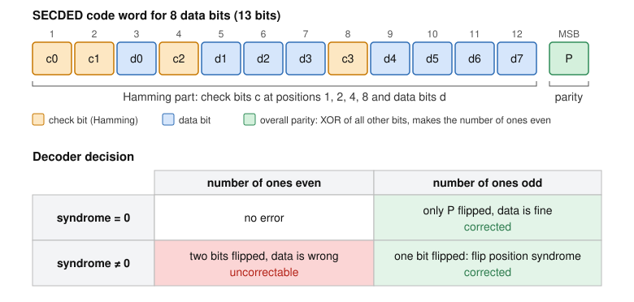

# ECC Generator

A Chisel generator for error correcting code (ECC) hardware.

Memories and communication links occasionally flip bits, for example because of
radiation or noise. An error correcting code adds a few **check bits** to each
data word, so that a flipped bit can be detected and corrected when the word is
read back. This is used in server memory (ECC RAM), caches, and space hardware.

Instead of writing the encoder and decoder by hand for one data width, this
project provides a **generator**: given the data width, it computes the code
layout and produces the matching encoder and decoder circuits.

Project for the [Agile Hardware Design](https://github.com/schoeberl/agile-hw)
course (02201) at DTU.

## Status

- **Sprint 1 (MVP)**: Hamming single error correction (SEC) for any data width.
- **Sprint 2**: SECDED (also detects double bit errors) and error outputs.

| Data bits | Check bits | SEC code word | SECDED code word |
|-----------|------------|---------------|------------------|
| 8         | 4          | 12            | 13               |
| 16        | 5          | 21            | 22               |
| 32        | 6          | 38            | 39               |
| 64        | 7          | 71            | 72               |

See [BACKLOG.md](BACKLOG.md) for planned features.

## How the Hamming code works

Code bits are numbered from position 1. Check bits sit at the positions that
are powers of two (1, 2, 4, 8, ...), data bits fill the remaining positions:

```
position:  1   2   3   4   5   6   7   8   9  10  11  12
content:  c0  c1  d0  c2  d1  d2  d3  c3  d4  d5  d6  d7     (8 data bits)
```

Check bit `ci` is the parity (XOR) of all positions whose number has bit `i`
set. For example, `c0` covers positions 1, 3, 5, 7, 9, 11.

When decoding, the check bits are recomputed. The failing checks form a binary
number, the **syndrome**, which is exactly the position of the flipped bit
(0 means no error). The decoder flips that bit back and extracts the data.

The number of check bits `r` is the smallest value with `2^r >= data bits + r + 1`,
so that every position plus "no error" has its own syndrome.

## SECDED: detecting double errors

The plain Hamming code (SEC) can only handle one flipped bit. If two bits flip,
the syndrome points to a third, innocent bit, and the decoder "corrects" it into
wrong data without noticing.

SECDED (single error correction, double error detection) fixes this with one
extra **overall parity bit** `P`, stored as the most significant bit. `P` is the
XOR of all other bits, so a valid code word always has an even number of ones.
Each flipped bit changes this even/odd count:

- **one** flipped bit: the count is odd, and the syndrome says where the error is
  (syndrome 0 means only `P` itself flipped) → corrected
- **two** flipped bits: the count is even again, but the syndrome is not zero →
  reported as uncorrectable, the data is not touched



This is the code used in ECC RAM: 64 data bits are stored as 72 bits.

### Decoder outputs

| Output | Meaning |
|--------|---------|
| `data` | the data word, with a single bit error fixed |
| `corrected` | one bit was flipped and has been fixed |
| `uncorrectable` | an error was detected that cannot be fixed, `data` is wrong (two flipped bits with SECDED) |
| `syndrome` | position of the flipped bit; 0 for no error or when only the parity bit `P` flipped |

Without SECDED, `uncorrectable` is only set when the syndrome points beyond the
code word, which is a rare case of a multi-bit error.

## Usage

Requirements: Java (JDK 17 or later) and [sbt](https://www.scala-sbt.org/).

Generate Verilog for the given data widths (default 8, 32, 64). For each width
both the SEC and the SECDED variant are written, to `generated/sec/` and
`generated/secded/`:

```
sbt "run 8 16 32"
```

Run the tests:

```
sbt test
```

Use the generator in Chisel:

```scala
import ecc._

val code = HammingCode(32)                 // SEC layout for 32 data bits (38 bit code word)
val code2 = HammingCode(64, secded = true) // SECDED layout for 64 data bits (72 bit code word)

val enc = Module(new HammingEncoder(code)) // io.data -> io.codeword
val dec = Module(new HammingDecoder(code)) // io.codeword -> io.data, io.corrected,
                                           //   io.uncorrectable, io.syndrome
```

## Structure

| File | Content |
|------|---------|
| [HammingCode.scala](src/main/scala/ecc/HammingCode.scala) | Code layout (plain Scala): number of check bits, bit positions |
| [Hamming.scala](src/main/scala/ecc/Hamming.scala) | Chisel encoder and decoder generated from the layout, Verilog emitter |
| [HammingTest.scala](src/test/scala/ecc/HammingTest.scala) | Reference model and tests |

The generator separates *what* the code looks like (`HammingCode`) from the
hardware that implements it (`HammingEncoder`, `HammingDecoder`).

## Testing

- A software **reference model** computes the code in a different way than the
  hardware (the XOR of the positions of all set bits is the syndrome), so the
  tests compare two independent implementations.
- For each tested width (1, 4, 8, 11, 16, 26, 32, 57, 64), the encoder output
  is compared with the model, and **every single bit flip** of the code word is
  checked to be corrected, with the syndrome pointing to the flipped bit. Widths
  up to 8 bits are tested exhaustively.
- For SECDED, the encoder is checked to add the correct parity bit, and the
  decoder is checked to correct every single flip and to report **every pair of
  flipped bits** as uncorrectable.
- Tests run automatically on every push with GitHub Actions
  ([ci.yml](.github/workflows/ci.yml)).

## Team

- Stefan Buzu, s260383 ([StefanBuzu](https://github.com/StefanBuzu))
- Igor Cretu ([igorcretu](https://github.com/igorcretu))

The development process (Scrum, sprints, tasks per person) is documented in
[BACKLOG.md](BACKLOG.md).

## Use of AI

We used Claude (an AI assistant) to help set up the project, implement the MVP
(generator, reference model and tests), implement the SECDED hardware in
sprint 2, write documentation, and review pull requests. We reviewed the code,
ran the tests, and made sure we understand how it works.

## License

[BSD 2-Clause](LICENSE)
